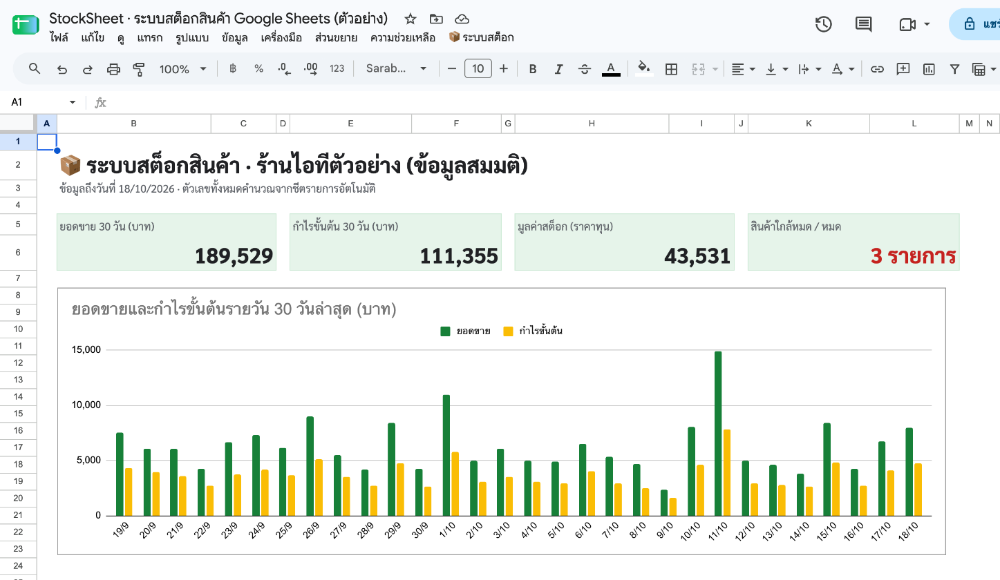
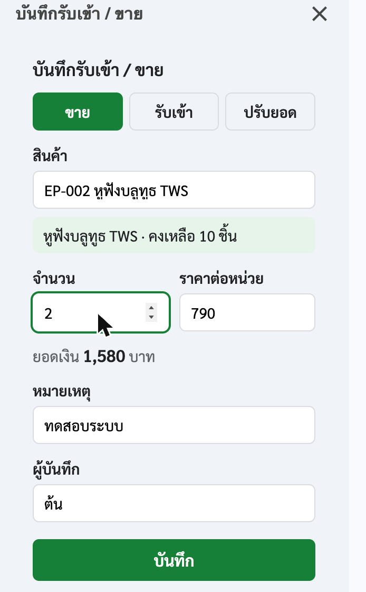
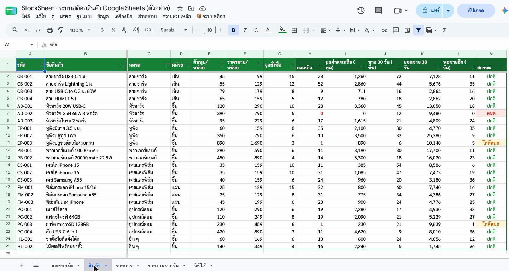

# StockSheet · ระบบสต็อกสินค้าบน Google Sheets + Apps Script

**ไฟล์ตัวอย่าง (เปิดดูได้ทันที):** https://docs.google.com/spreadsheets/d/1StzdWH9a6PeBuoPHGpPkHBsZkS7mTth2R7a0ojTzqeE/edit
**ทำสำเนาไปใช้เอง (สคริปต์ติดไปด้วย):** https://docs.google.com/spreadsheets/d/1StzdWH9a6PeBuoPHGpPkHBsZkS7mTth2R7a0ojTzqeE/copy

ระบบสต็อกสำหรับร้านค้าขนาดเล็กที่ใช้ Google Sheets ที่มีอยู่แล้ว ไม่ต้องซื้อโปรแกรมเพิ่ม
บันทึกรับเข้าและขายผ่านฟอร์ม ระบบเช็คสต็อกก่อนบันทึก แดชบอร์ดสรุปยอดขาย กำไร และสินค้าที่ต้องสั่งซื้อ
และส่งแจ้งเตือนของใกล้หมด กับสรุปยอดขายประจำวันไป Telegram, LINE หรืออีเมลได้อัตโนมัติ

ข้อมูลในไฟล์ตัวอย่างเป็นร้านไอทีสมมติ มีสินค้า 24 รายการ และรายการเคลื่อนไหวย้อนหลัง 60 วัน (1,017 รายการ) ที่สร้างจากสคริปต์ในโปรเจกต์นี้



## ทำอะไรได้บ้าง

| ส่วน | รายละเอียด |
|------|------------|
| **แดชบอร์ด** | ยอดขายและกำไรขั้นต้น 30 วัน, มูลค่าสต็อก, กราฟรายวัน, สินค้าขายดี 5 อันดับ, รายการที่ต้องสั่งซื้อ อัปเดตทันทีเมื่อมีรายการใหม่ |
| **ชีตสินค้า** | คงเหลือ มูลค่าคงเหลือ ยอดขาย 30 วัน "พอขายอีกกี่วัน" และสถานะ ปกติ / ใกล้หมด / หมด คำนวณด้วยสูตรทั้งหมด |
| **ฟอร์มบันทึก** (เมนู ➕) | แถบด้านข้าง ค้นหาสินค้าด้วยชื่อหรือรหัส เติมราคาให้เอง โชว์คงเหลือ และไม่ยอมให้ขายเกินสต็อก (ใช้ LockService กันบันทึกชนกันเมื่อหลายคนใช้พร้อมกัน) |
| **พิมพ์ในชีตตรง ๆ** | dropdown ประเภทและรหัสสินค้า, ตรวจค่าที่กรอก, ใส่วันที่เวลาให้เองเมื่อเลือกรหัส |
| **แจ้งเตือน** (เมนู 🔔 ⚙️ ⏰) | Telegram Bot, LINE Messaging API และอีเมล ปุ่มทดสอบส่ง และสรุปอัตโนมัติทุกวันตามเวลาที่ตั้ง |
| **ความปลอดภัย** | token เก็บใน Document Properties ไม่แสดงในชีต ไม่ติดไปกับไฟล์ที่ทำสำเนา และสคริปต์ขอสิทธิ์เฉพาะไฟล์นี้ (`@OnlyCurrentDoc`) |

<table><tr>
<td></td>
<td></td>
</tr></table>

## เริ่มใช้งาน

**วิธีที่ 1: ทำสำเนา (ง่ายที่สุด)**
เปิดลิงก์ "ทำสำเนา" ด้านบน ไฟล์และสคริปต์จะอยู่ใน Google Drive ของคุณ เปิดไฟล์แล้วรอเมนู **📦 ระบบสต็อก** ขึ้นที่แถบเมนู
ครั้งแรกที่กดเมนู Google จะให้ยืนยันสิทธิ์ของสคริปต์ในบัญชีของคุณเอง

**วิธีที่ 2: ติดตั้งในชีตเปล่า**
1. สร้าง Google Sheets ใหม่ › ส่วนขยาย › Apps Script
2. วางโค้ดจาก [`dist/Code.gs`](dist/Code.gs) แล้วเพิ่มไฟล์ HTML ชื่อ `Sidebar` และ `Settings` จาก [`dist/`](dist/)
3. เลือกฟังก์ชัน `setup` แล้วกด Run ระบบจะสร้างชีตทั้งหมดพร้อมข้อมูลตัวอย่าง

**วิธีที่ 3: clasp (สำหรับนักพัฒนา)**
```bash
npm i -g @google/clasp && clasp login
cp .clasp.json.example .clasp.json   # ใส่ scriptId ของโปรเจกต์คุณ
clasp push
```

## โครงสร้างโค้ด

| ไฟล์ | หน้าที่ |
|------|---------|
| [`src/Stock.js`](src/Stock.js) | ตรรกะล้วน: คำนวณสต็อก ตรวจรายการ หาสินค้าใกล้หมด สรุปรายวัน สร้างข้อมูลตัวอย่าง (ไม่เรียก SpreadsheetApp จึงเทสต์ด้วย Node ได้) |
| [`src/Main.js`](src/Main.js) | เมนู, onEdit, อ่านชีต, บันทึกจากฟอร์ม, ตรวจของใกล้หมด, trigger รายวัน |
| [`src/Setup.js`](src/Setup.js) | สร้างทั้งไฟล์จากชีตเปล่า: ชีต สูตร รูปแบบ dropdown การป้องกันช่องสูตร กราฟ |
| [`src/Notify.js`](src/Notify.js) | ส่ง Telegram / LINE / อีเมล และตั้งค่าที่เก็บใน Document Properties |
| [`src/Sidebar.html`](src/Sidebar.html), [`src/Settings.html`](src/Settings.html) | ฟอร์มบันทึก และหน้าตั้งค่าการแจ้งเตือน |
| [`test/stock.test.js`](test/stock.test.js) | เทสต์ 8 ชุด รันด้วย `npm test` |

สูตรสำคัญในชีต:
- คงเหลือ: `SUMIF` ของคอลัมน์ "เปลี่ยนแปลงสต็อก" (ขาย = ลบ, รับเข้า = บวก, ปรับยอดใส่ค่าบวกหรือลบ)
- ยอดขาย 30 วันต่อสินค้า และรายงานรายวัน: `MAP` + `LAMBDA` ครอบ `SUMIFS` เพราะ `SUMIFS` ใช้กับ `ARRAYFORMULA` ไม่ได้
- ทุกช่วง "30 วันล่าสุด" อิงวันที่ล่าสุดที่มีข้อมูล (named range `REF_DATE`) ไฟล์ตัวอย่างจึงไม่โชว์ศูนย์เมื่อเวลาผ่านไป

```bash
npm test          # เทสต์ตรรกะใน Node
npm run bundle    # รวม src/*.js เป็น dist/Code.gs สำหรับวางใน Apps Script editor
```

## ข้อจำกัด

- Google Sheets เหมาะกับร้านที่มีรายการไม่เกินหลักหมื่นถึงแสนแถว ถ้าใหญ่กว่านั้นควรย้ายไปใช้ฐานข้อมูล
- trigger รายวันของ Apps Script ส่งตามช่วงชั่วโมงที่ตั้งไว้ อาจคลาดเคลื่อนได้ภายในชั่วโมงนั้น
- LINE Notify ปิดบริการแล้ว (มี.ค. 2025) จึงใช้ LINE Messaging API ซึ่งต้องสร้าง LINE Official Account และ channel access token

---

ทำโดย Chanavee (นักศึกษาวิศวกรรมคอมพิวเตอร์ มจธ.) · รับทำ Google Sheets อัตโนมัติผ่าน [Fastwork](https://fastwork.co/user/chasvitf) · โค้ดเผยแพร่ภายใต้ [MIT](LICENSE)

**English:** StockSheet is a small-shop inventory system on Google Sheets. Apps Script builds the workbook (formulas, validation, protected ranges, charts, demo data), adds a sidebar entry form that refuses to sell more than is in stock, and sends low-stock alerts and a daily sales summary to Telegram, LINE (Messaging API) or email. Pure logic is unit-tested in Node.
